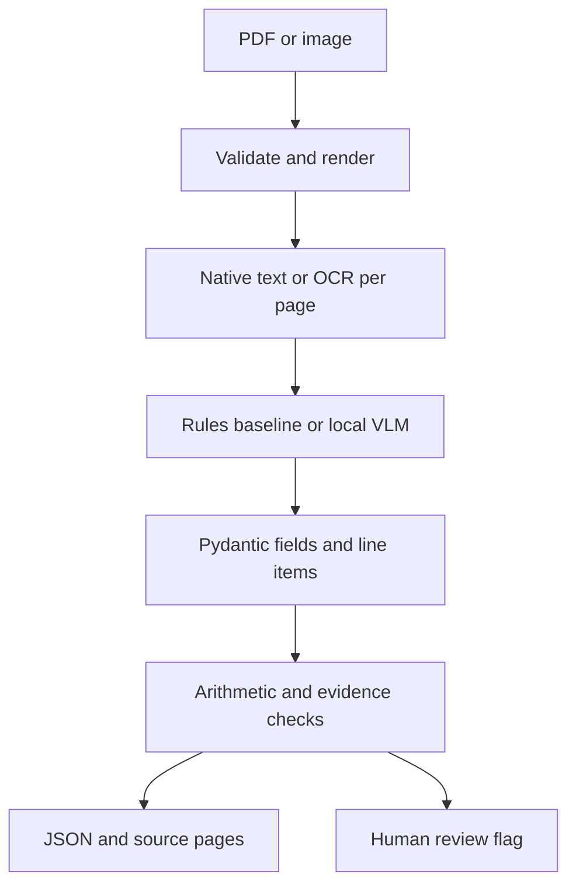

# DocIntel

Local multimodal invoice and credit-note intelligence: document → text/page images → structured extraction → deterministic validation → source evidence → review decision.

## Overview and real-world problem
Billing documents mix native PDF text, scans, forms and tables. DocIntel extracts explicit billing fields and structured line items, checks arithmetic and required values, preserves page quotes and flags uncertain results. It is a focused single Python application. It does not authorize payments.

## What the project demonstrates
Implemented: PDF/PNG/JPEG input validation, per-page native/OCR routing, page rendering, invoice/credit-note classification, a deterministic template baseline, Pydantic schemas, cross-page line-item aggregation, arithmetic checks, source quote checks, heuristic quality scoring, review flags, a FastAPI upload/inspection interface, CLI, synthetic fixtures, evaluation and tests.
Optional implemented integration: a real locally loaded Hugging Face vision-language model using rendered page images plus parsed text. No model inference, tests or evaluation were run while generating this repository. No quality scores are claimed.
Future: independently authored real-layout datasets, better table/layout extraction, adjudicated evidence, calibrated acceptance, larger-model comparisons and a reviewer UI.

## Architecture and pipeline

One process handles the pipeline. Both extraction adapters implement the same Candidate contract. A malformed model response produces an empty extraction with explicit warnings and review, never a hidden baseline fallback. Classification is derived from text by rules or jointly from images/text by the VLM.

## Supported document types
Invoice and credit note use the same billing schema. Supporting attachments and unknown types are returned with review required. Input: unencrypted PDFs (1–5 pages), PNG and JPEG, maximum 10 MiB and 20 million pixels per image. Native PDF pages with at least 40 text characters bypass OCR; other pages use Tesseract. This heuristic can miss mixed pages with enough native text and embedded scanned content. PDF pages are rendered to bounded page images. English OCR only by default.

## Model choice
Default `rules` is a transparent template baseline, **not a multimodal model**. It recognizes labeled fields and explicit `Item: description | quantity | unit price | amount` rows. It is useful for first setup and controlled comparisons, not arbitrary business layouts.
Optional `local_vlm` uses [SmolVLM-256M-Instruct](https://huggingface.co/HuggingFaceTB/SmolVLM-256M-Instruct), Apache-2.0, a small image-text model selected for approachable local experimentation. It receives all page images and parsed text and requests schema-shaped JSON. A 256M model may fail complex extraction or JSON formatting. Every VLM result currently requires review because this adapter has not been validated. This is a conservative policy, not a measured uncertainty estimate. CPU runs may be slow; memory/latency have not been benchmarked. Transformers is constrained to the 4.x API. Changing the model requires a compatible AutoModelForVision2Seq/processor pair; this is not a universal provider adapter.

## Parsing/OCR strategy
pypdf reads native text; pypdfium2 renders pages; Pillow validates/normalizes images; pytesseract calls the system Tesseract executable only for pages without substantial native text. No OCR executable means vision-only pages, warnings and review. Rendered images are saved beside results for inspecting evidence. No chart-value extraction or general cell-coordinate reconstruction is claimed.

## Structured schemas and validation rules
Fields: vendor, customer, document_number, document_date (ISO date), currency (USD/EUR/GBP/INR/CAD/AUD), subtotal, tax, total and line_items (description, quantity, unit_price, amount). Decimal arithmetic avoids floating point money errors. Credits use positive amounts representing a credit; signed credit-note conventions are unsupported.
Checks require billing type, core fields, at least one row, subtotal + tax = total, sum of row amounts = subtotal, quantity × price = row amount, with 0.02 currency-unit tolerance. Pydantic rejects invalid dates/enums, negative amounts and unexpected model keys. Conflicting labels, malformed rows and extraction failures cause review. Full-document tax/business/compliance rules are outside scope.

## Evidence grounding and human review logic
Evidence stores field path, 1-based page and exact source quote. The pipeline verifies normalized quote presence and that the value appears in it; this is lexical support, not semantic proof that the correct label/value relationship was selected. OCR boxes are approximate unions of matching word tokens in rendered-image pixels and can over-include repeated words. Native text has page/quote references without bounding boxes. Vision-only values cannot be text-verified and require review.
Confidence is the fraction of deterministic checks passed, explicitly a heuristic quality score, **not a calibrated probability**. Any failed check/warning requires review. OCR mean word confidence below 0.65 requires review. A high score does not override a failed check. A trained reviewer must inspect source pages; no approval/writeback workflow is implemented.

## Repository structure
`src/docintel/` contains schemas, parsing, extraction, vision, validation, pipeline, API, CLI and evaluation. `scripts/generate_samples.py` creates original synthetic PDFs/images and labels. `data/sample/` includes clean native, PNG/JPEG/PDF scans, cross-page table, credit note, incomplete, conflicting and ambiguous documents. `evals/manifest.json` holds ground truth. `tests/` uses fakes for model failures. `docs/` explains evaluation and licenses. Generated `outputs/` is gitignored.

## Prerequisites and Debian setup
Python 3.11+, uv, system Tesseract for scans, VS Code optionally. From a Debian terminal:
```bash
sudo apt update
sudo apt install -y curl unzip tesseract-ocr tesseract-ocr-eng
curl -LsSf https://astral.sh/uv/install.sh | sh
source "$HOME/.local/bin/env"
uv --version
unzip DocIntel.zip
cd DocIntel
uv python install 3.11
uv sync --frozen --python 3.11
```
Core installation includes dev tools but excludes Torch/Transformers. `uv python install 3.11` is the correct uv command. The lockfile resolves metadata, not model weights. Downloads need internet. No API key is required.

## VS Code setup
```bash
code .
```
Install Microsoft's Python extension. Use Command Palette → Python: Select Interpreter → `.venv/bin/python`. Open a new terminal in the DocIntel root. All commands below assume this directory. `uv run` automatically uses its virtual environment.

## Installation and environment variables
`uv sync --frozen --python 3.11` is sufficient for the baseline. `.env.example` documents settings but is **not automatically loaded**. For the API, export values explicitly:
```bash
export DOCINTEL_BACKEND=rules
export DOCINTEL_OUTPUT_DIR=outputs
```
Optional variables: `DOCINTEL_MODEL` defaults to HuggingFaceTB/SmolVLM-256M-Instruct; `DOCINTEL_DEVICE` defaults to cpu, accepts cuda if available. CLI selects its backend/output directory with flags; model/device variables still apply. Output directories contain copies of source page images; use synthetic data and delete outputs when finished.

## Processing a sample document
```bash
uv run docintel process data/sample/native_invoice.pdf
uv run docintel process data/sample/scanned_invoice.png
uv run docintel process data/sample/table_invoice.pdf
```
Output is JSON on stdout and `outputs/<document_id>/result.json` plus `page-N.png`. Inspect document_type, extracted_fields, evidence, validation_results, warnings and review_required. No precomputed output or quality claims are included. For conflicts the baseline preserves the first value and explicitly flags the conflict. Cross-page rows preserve source order; repeated headers are harmless but repeated item rows are not deduplicated.

## Optional local vision model
Only when ready to download dependencies and model weights:
```bash
uv sync --frozen --extra vision --python 3.11
uv run --extra vision docintel process data/sample/native_invoice.pdf --backend local_vlm
```
First use downloads the Hugging Face model into its normal cache (not this repository). The processor receives page images on native documents too. No model weights are packaged. To request CUDA: `export DOCINTEL_DEVICE=cuda` with a working CUDA-compatible Torch installation; the project does not provision GPU drivers. Errors appear as review warnings in the result, so inspect warnings even if the command exits successfully.

## Running the app/API
```bash
uv run uvicorn docintel.api:app --host 127.0.0.1 --port 8000
```
Open http://127.0.0.1:8000/docs. Expand POST /documents, Try it out, choose a sample, Execute. Copy document_id. GET /documents/{document_id} returns saved JSON; GET /documents/{document_id}/pages/{page} returns source PNGs. /health does not load a model. In another terminal:
```bash
curl -X POST http://127.0.0.1:8000/documents -F 'document=@data/sample/native_invoice.pdf'
```
To use VLM via API:
```bash
DOCINTEL_BACKEND=local_vlm uv run --extra vision uvicorn docintel.api:app --host 127.0.0.1 --port 8000
```
Single-process local server only; one processing request at a time, HTTP 429 when busy. API has no authentication, automatic cleanup or production multipart quota; bind to localhost and use trusted sample files. Uploads are size-checked after the multipart parser spools them, so the byte limit is not a production ingress resource defense.

## Running evaluation (later, explicitly opt-in)
```bash
uv run docintel evaluate --backend rules
uv run --extra vision docintel evaluate --backend local_vlm --output outputs/vision-evaluation.json
```
See docs/evaluation.md. Reports include classification metrics, annotated field match/PRF, numeric tolerance, ordered row match, evidence page correctness, reconciliation rate and review accuracy. These nine synthetic fixtures are a smoke dataset, not a representative benchmark. No results were generated during packaging.

## Running tests (later)
```bash
uv run pytest
uv run ruff check src tests scripts
```
Tests cover routing without OCR for native PDFs, invalid inputs, schemas, classification, arithmetic, evidence, conflicts, OCR quality, model failure review and API input validation. Tests do not load real models. Ruff is an optional development check; formatting/lint have not been executed during generation.

## Regenerating samples
```bash
uv run python scripts/generate_samples.py
```
Only generates synthetic documents/annotations; it does not run OCR or extraction.

## Docker
```bash
docker build -t docintel .
docker run --rm -p 127.0.0.1:8000:8000 -v "$PWD/outputs:/app/outputs" docintel
```
Default image includes Tesseract and baseline only. Docker build/run were not executed. Use host instructions for the optional VLM.

## Known limitations and future upgrades
This generated repository is ready for local debugging, not validated production software. Rules depend on explicit synthetic labels/row delimiters. Small VLM JSON fidelity, resource usage and extraction quality remain unmeasured. OCR quality is a heuristic and does not catch all mistakes. Quotes/numeric occurrences provide partial lexical evidence only; complex layouts, visual-only grounding, charts, currency-specific rounding, multi-language scans, ambiguous signed credits and duplicate table rows need further work. No persistent database, authentication, approval actions or cross-document matching is implemented.
Prioritize local setup, a sample inspection, then tests/evaluation when you choose. Future additions should be backed by failure examples and independent labels.

## License
MIT original code and original synthetic fixtures. See LICENSE and docs/licensing.md for dependency/model considerations. No private documents, credentials or model weights are included. GitHub push/deployment is left to you after local validation.
